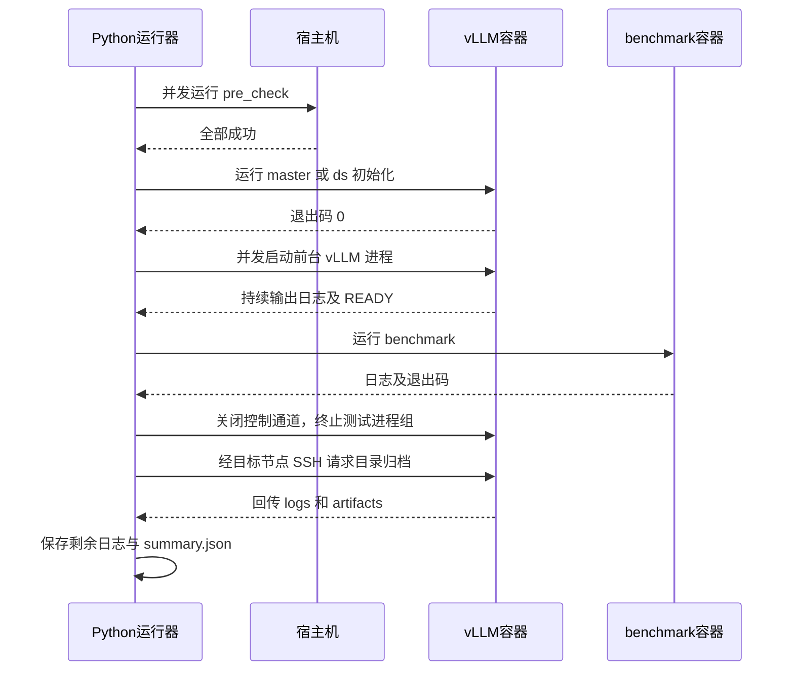

# 多节点容器测试编排

标准库 Python 运行器；约定每个用例目录用 `case.json` 描述编排，无需安装 Python 包。
控制端需要 Linux、Python 3.8+、OpenSSH；目标宿主机和容器需要 Linux、`sh`、`tar`、
Python 3.8+ 及业务脚本依赖。容器须已启动，SSH 用户须有 Docker 执行权限。
不负责创建容器、安装依赖或实现 vLLM/DataSystem/ais_bench 的业务脚本。

## 快速使用

1. 复制 `examples/case1`（或 case2/case3）到自己的用例目录。
2. 把对应业务脚本及依赖文件放入该目录。脚本必须有 shebang 和可执行权限，例如
   `chmod +x case1/*.sh`。模板不包含伪造成功的业务脚本。
3. 配置 `~/.ssh/config` 中的 `node1` / `node2` 别名及密钥认证，并预先确认主机指纹。
   `case.json` 的 `nodes` 保存别名，不保存密码或密钥内容；非默认端口/用户在 SSH config 中配置。
4. 调整 `case.json` 中的容器名、READY 文本和超时，运行：

```bash
python3 tools/case_runner/runner.py ./case1 --check
python3 tools/case_runner/runner.py ./case1 --output ./results
```

`--check` 仅校验本地配置、脚本存在性和可执行权限，不连接远端，不验证远端依赖。
`--output` 是可重复使用的结果根目录，必须位于用例目录和公共源目录外；默认 `case-runs`。
每次运行生成独立的 `<结果根目录>/<case目录名>/<run_id>/`，不会覆盖前次结果。
退出码：0 表示步骤、收尾及文件回传全部成功，1 表示失败/超时/中断/回传失败。

节点定义直接写入 `case.json`，不需要独立的 inventory 文件或命令行参数：

```json
{
  "nodes": {
    "node1": {"ssh": "node1"},
    "node2": {"ssh": "node2"}
  },
  "targets": {
    "host1": {"node": "node1"},
    "vllm1": {"node": "node1", "container": "vllm_test1"},
    "vllm2": {"node": "node2", "container": "vllm_test2"}
  }
}
```

以上是配置片段，完整配置见 examples。本机调试可将节点改为 `{"local": true}`；
目标有 `container` 时仍执行 Docker。未指定 container 才在宿主机执行。

## 配置契约

| 配置 | 语义 |
| --- | --- |
| `version` | 固定为 1；未知字段拒绝，避免拼写错误静默生效 |
| `nodes` | 节点名到 `{ssh: "SSH别名"}` 或 `{local: true}` 的映射 |
| `targets` | 目标名到 `{node, container?}` 的映射；不填 container 明确表示宿主机 |
| `shared_dirs` | 可选的公共目录映射：目标目录别名 → 控制端源目录路径，相对路径以 case.json 所在目录为基准 |
| `steps` | 按数组顺序执行；每项只能有一个 `run`、`start` 或 `wait_log` |
| `run: [job, ...]` | 并发启动有限任务，全部退出码为 0 才继续；任一失败立即停止后续编排 |
| `start: [job, ...]` | 并发启动常驻任务后继续；直到用例收尾，任一任务提前退出（包括 0）都算失败 |
| `wait_log` | 等待此前 start 任务的 console 或文件包含 UTF-8 字面文本；不是正则 |
| 步骤 `timeout` | run 完成 / wait_log 就绪的最长等待秒数，默认 600；start 不接受此字段 |
| 顶层 `timeout` | 从分发到最后一步的总超时，默认 3600 秒；不包含失败采集窗口、清理和文件回传 |
| `failure_collect_seconds` | 任何失败后停止派发新任务，但保留已启动任务并继续采集的秒数；默认 0 |
| `collection_timeout` | 每个 target 的日志/产物传输及解包超时，默认 120 秒；最多 4 个 target 同时回传 |

`run` / `start` 中的每个 job 必须在 `script` 与 `command` 中二选一。
两者可在同一组任务中混用；不能同时填写，也不能都不填。

脚本形式：

```json
{
  "id": "vllm1",
  "target": "vllm1",
  "script": "vllm_node1.sh",
  "args": ["--model", "/models/example"],
  "env": {"PYTHONUNBUFFERED": "1"}
}
```

`id` 全用例唯一；`target` 引用 targets。`script` 是用例内相对路径；
`args` 是字符串数组，不经过 shell 展开；`env` 叠加目标环境，**不要写入密钥**。
脚本工作目录是本任务的 `CASE_WORK_DIR`；引用随用例分发的文件请使用 `$CASE_DIR/文件名`。
运行器拥有下文五个目录环境变量，job.env 不允许覆盖它们。
bash 脚本建议 `set -euo pipefail`，确保内部失败反映到退出码。

直接命令形式：

```json
{
  "start": [
    {
      "id": "vllm1",
      "target": "vllm1",
      "command": "exec python3 -u -m vllm.entrypoints.openai.api_server --model /models/example > \"$CASE_LOG_DIR/server.log\" 2>&1"
    }
  ]
}
```

`run` 同样支持 `command`，例如：

```json
{"run": [{"id": "check", "target": "host1", "command": "test -d /models/example && printf 'check OK\\n'"}]}
```

- `command` 是非空字符串，通过**目标宿主机或容器内的 `sh -c`** 执行，不在控制端展开。
  支持引号、环境变量、重定向、管道、`&&` 和多行命令；仅执行可信配置。
- `args` 只用于 script。command 的参数直接写在命令字符串中，不再额外填写 args。
- command 与 script 使用相同的 `env`、`CASE_WORK_DIR`、就绪检查、超时、进程组清理和自动采集。
  常驻命令也必须保持前台，推荐使用 `exec`；不要通过 `&` 或 daemonize 脱离托管。
- 返回码遵循目标 `sh` 的语义：通常是最后一条命令或管道最后一段的返回码。
  依赖步骤请用 `&&` 连接，避免 `false; echo OK` 掩盖失败。
  如需 Bash 的 `pipefail`，在目标安装 Bash，并显式使用 `bash -o pipefail -c '...'`。

## 多个用例共用脚本

公共脚本集中维护，不必复制到每个用例目录：

```text
test_cases/
├── common/
│   ├── pre_check.sh
│   └── utils.sh
├── case1/
│   └── case.json
└── case2/
    └── case.json
```

在每个用例的 `case.json` 中声明源目录，并使用带别名的明确路径。以下为配置片段：

```json
{
  "shared_dirs": {
    "common": "../common"
  },
  "steps": [
    {
      "run": [
        {"id": "pre1", "target": "host1", "script": "common/pre_check.sh"},
        {"id": "pre2", "target": "host2", "script": "common/pre_check.sh"}
      ]
    }
  ]
}
```

`start` 同样可以使用公共 script。command 或其他脚本通过 `$CASE_DIR/common/文件名`
引用公共文件，例如 `bash "$CASE_DIR/common/pre_check.sh"` 或 `source "$CASE_DIR/common/utils.sh"`。
POSIX sh 中加载函数文件使用 `. "$CASE_DIR/common/utils.sh"`。

| 规则 | 行为 |
| --- | --- |
| 源路径 | 相对于 case.json 所在目录解析，与启动 runner 的工作目录无关；也支持绝对路径，不展开 `~` 或环境变量 |
| 别名 | 一个普通目录名，不允许路径分隔符；如 `common`、`helpers`，多个公共目录可分别声明 |
| 分发 | 将源目录的全部内容打包为目标侧 `$CASE_DIR/<别名>/`，经现有 SSH/Docker 通道分发到每个 target |
| 本地目录 | 不创建或修改本地 case 下的公共目录；目标副本按 run_id/target 隔离 |
| 路径冲突 | 别名与 case 内已有文件、目录或保留文件名重名时直接报错，不覆盖 |
| 文件校验 | 源目录必须存在；拒绝经过符号链接的源路径以及目录内的符号链接、特殊文件；script 必须可执行 |
| 目录范围 | 源目录不能是 case 自身、case 的祖先或子目录；已有 case 内文件直接引用，不重复映射 |
| 输出目录 | 不能位于 case 或任何公共源目录内，避免将运行结果再次打包 |

可通过 `--check` 提前验证声明和公共 script 引用。公共目录里的辅助文件不要求可执行，
只有作为 script 调用的入口才要求可执行。只分发显式声明的目录，不自动搜索父目录中的同名脚本。
不要把模型、密钥或大量无关文件放进公共源目录；打包期间不要修改源文件。
分发完成后修改控制端公共脚本不会改变已经启动的目标副本，下次运行重新分发。
运行时生成的文件仍应写入 `CASE_WORK_DIR`、`CASE_LOG_DIR`、`CASE_ARTIFACT_DIR`。

## 等待标准输出或文件日志

默认 `source: console` 检查 stdout/stderr 合流：

```json
{"wait_log": {"job": "vllm1", "source": "console", "contains": "READY"}, "timeout": 600}
```

文件模式在 job 所在的节点/容器中检查，不是在控制端：

```json
{"wait_log": {"job": "vllm1", "source": "file", "path": "server.log", "contains": "READY"}, "timeout": 600}
```

- 相对 path 以该 job 的 `CASE_LOG_DIR` 为基准，也可指定目标环境内的绝对路径；不允许 `..`。
- 文件尚未创建会继续等待；权限错误、非普通文件等立即报错。业务需及时 flush 文件缓冲。
- 两种模式均从任务启动时就监听，条件命中后保留结果，后续到达 wait_log 步骤也能识别。
  文件模式在启动业务进程前记录已有文件末尾位置，不匹配启动前的旧内容。
- 增量读取，支持无换行、跨块文本和长行；跟随 pathname 变化处理轮转，文件变短或已读位置
  附近内容改变时从头读取。轮询间隔内多次轮转，或截断后重新增长且已读位置附近内容未变时可能漏检；
  推荐使用本次任务独立的日志文件，不要复用其他测试仍在写的文件。
- 等待期间仍持续检查常驻任务是否退出；历史 READY 不能让已退出的服务被认为健康。
  要等两个服务就绪，可连续增加两个 wait_log。
- 使用独特文本，避免错误日志也包含相同字符串。绝对路径文件可以用于就绪检查，
  但自动回传范围仍仅限下面约定的两个目录；需要保留的文件应写入或复制到这两个目录。

## 目录与自动回传

每个 target 在其宿主机或容器中拥有独立的运行目录；每个 job 也有独立子目录：

```text
/tmp/case-runner-<run_id>/<target>/
├── case/                     # 分发的用例脚本及辅助文件
├── work/<job_id>/            # 任务工作目录
├── logs/<job_id>/            # 业务日志
└── artifacts/<job_id>/       # 结果文件、报告等产物
```

| 环境变量 | 目标环境中的位置 |
| --- | --- |
| `CASE_RUN_DIR` | `/tmp/case-runner-<run_id>/<target>` |
| `CASE_DIR` | `$CASE_RUN_DIR/case` |
| `CASE_WORK_DIR` | `$CASE_RUN_DIR/work/<job_id>`，也是工作目录 |
| `CASE_LOG_DIR` | `$CASE_RUN_DIR/logs/<job_id>` |
| `CASE_ARTIFACT_DIR` | `$CASE_RUN_DIR/artifacts/<job_id>` |

目录由运行器预先创建。业务脚本只需把日志、产物写到对应目录：

```bash
#!/usr/bin/env bash
set -euo pipefail
exec python3 -u "$CASE_DIR/server.py" > "$CASE_LOG_DIR/server.log" 2>&1
```

测试成功、失败、超时或处理中断后，运行器都会先停止托管进程、排空输出，再自动回传
所有已准备 target 的 `logs/` 和 `artifacts/`。这包含各任务的 `CASE_LOG_DIR` 和
`CASE_ARTIFACT_DIR` 全部普通文件，不需要逐项列目录。业务应在 TERM 后及时 flush；
超过退出宽限期被 KILL 的进程可能丢失尚未写入文件的缓冲。

跨节点容器使用 **SSH 到对应宿主机，再执行该节点的 `docker exec ... tar`**，
将归档流直接回传控制端，不需要共享挂载、手动拷贝或宿主机临时目录。
容器必须仍在运行；容器停止或节点不可达时记录回传失败，继续处理其他 target。
此处不停止整个容器，只终止运行器托管的进程。

```text
results/<case_name>/<run_id>/
├── summary.json
├── prepare/<target>.log       # 脚本分发日志
├── console/
│   └── <job_id>.log
├── collection/<target>/
│   ├── transfer.log          # tar/SSH/Docker 传输诊断
│   └── files.partial/        # 仅解包失败时可能保留，不作为完整结果
└── artifacts/<target>/
    ├── logs/<job_id>/        # 对应 CASE_LOG_DIR
    └── artifacts/<job_id>/   # 对应 CASE_ARTIFACT_DIR
```

回传采用磁盘暂存归档，流式解包，不把全部文件加载到内存；控制端临时目录及输出盘须有
足够空间。拒绝路径越界、符号链接、硬链接和特殊文件，避免归档写出结果目录。
请输出普通文件，不要用软链接把其他日志目录接入采集范围。解包完整成功后才发布该 target
的结果目录；失败的部分文件留在 `collection/<target>/files.partial/`，远端原文件保留。

`summary.json` 分开记录原始测试错误、清理错误、回传错误，以及各 target 的采集状态：
`ok` / `failed` / `not_prepared`。一个 target 失败不阻止其他 target 回传。
即使业务步骤成功，清理或回传失败也会使最终退出码为 1。

## 三个样例

| 模板 | 步骤 |
| --- | --- |
| `examples/case1/case.json` | 两宿主机 pre_check → node1 master → 两节点 vLLM 并发 → vllm1 READY → benchmark |
| `examples/case2/case.json` | 两宿主机 pre_check → node1 ds1 → node2 ds2 → 两节点 vLLM 并发 → vllm1 READY → benchmark |
| `examples/case3/case.json` | 两宿主机 pre_check → node1 ds1 → node1 get → 文件 get.log 中的 GET_READY → node2 set |

样例三统一使用 `start_ds1.sh` 和 `start_bench1_get.sh`，分别对应问题中不一致的
`start_master.sh` / `start_ds1.sh`、`start_bench_get.sh` / `start_bench1_get.sh`。
其中 get 按常驻服务处理，必须在 set 完成前保持前台运行。
case3 的 get 脚本应将日志写到 `$CASE_LOG_DIR/get.log`。
若 get 本身是预期会结束的有限任务，应按实际业务调整编排，不能用 start 后忽略提前退出。



## 进程生命周期与日志

- 用例目录全部打包，经 SSH / `docker exec -i` 分发到各目标唯一的
  `/tmp/case-runner-<run_id>/<target>/case`。仅接受常规文件/目录，拒绝符号链接。
  不把模型、大数据集、私钥放进用例目录；模型通过目标上已有的绝对路径引用。
- `run` 的初始化脚本必须自行确认业务已成功，不应仅启动后台进程就返回 0。
  **所有由运行器托管的进程应保持前台运行**，最好以 `exec` 启动主进程。
  普通后台子进程会随脚本退出被清理。因此需要持续运行的 master/ds 应改用
  `start + wait_log`，而不是直接照抄示例中的有限初始化 `run`。
- 每个任务在目标环境独立进程组中运行；正常完成、失败、中断时关闭控制通道，
  目标监管器对该任务进程组 TERM，最多等 2 秒后 KILL。不使用 `pkill` 或停止整个容器。
  控制端每秒发心跳；15 秒无心跳或 stdin EOF 会终止目标任务。
  业务 stdin 为 `/dev/null`，不支持交互脚本或 TTY。
- Ctrl+C / SIGTERM 跳过失败采集窗口，进行收尾。控制端强杀、网络分区时依赖心跳过期；
  若目标监管器自身被 SIGKILL、节点失联或进程进入不可中断 IO，不能保证清理成功。
  主动 `setsid`、daemonize、Docker/socket API 启动的外部服务不在进程组清理保证内；
  不应用这类脱离托管的方式启动被测常驻任务。
- 每个任务的 stdout 与 stderr 合流写入 `console/<id>.log`，原始字节实时刷新；
  分发日志为 `prepare/<target>.log`。不自动抓取 `docker logs` 或约定范围外的文件。
- benchmark 失败后，示例保留服务继续采集 60 秒；随后终止服务，最终仍返回失败。
  服务提前退出也停止后续编排，执行相同采集策略；要立即收尾可设为 0。
  benchmark 成功后立刻收尾并排空剩余日志。两种情况下都自动回传目录。
- `summary.json` 记录结论、失败原因、任务返回码、日志位置、事件时间和远端目录；
  正常收尾中常驻进程的非零退出码不作为业务失败。未启动的任务不会生成任务日志。
  远端副本和运行文件保留供排查，使用 summary 中的精确目录人工清理；重复运行不复用目录。
  控制端 SIGKILL 或崩溃无法执行文件回传，只能在恢复连接后人工取回远端目录。
- 日志匹配内存只保存匹配文本所需尾部，不把全量日志装入内存。
  磁盘日志无轮转，运行前预留空间并设置合理总超时；业务日志可能含敏感信息，
  输出目录默认仅当前用户可访问，分享前应脱敏。日志写入失败使用例失败。

这是测试工具，不接入 SDK、CMake/Bazel 或默认集群测试，也不改变生产服务。
先用本机脚本验证配置，再在隔离容器上联调；回退仅需停止使用工具。
配置与脚本均视为可信输入，不是执行不可信代码的安全沙箱。

## 回归测试

```bash
python3 -m unittest discover -s tools/case_runner -p 'test_*.py' -v
```

测试使用临时目录和本机真实子进程，另验证 SSH/Docker 命令构造；
不代表实际多机 SSH、Docker 权限、GPU/NPU 或业务依赖已验证。

## D2RH/RH2D 数据校验示例

examples/d2rh_validation 提供预部署 Worker A/B 的有限任务编排：A put 校验成功后 B get 校验，
通过 shared_dirs 分发 bench、--verify-data 开关和 artifacts JSON 回传，无需更改运行器协议。
见该目录 README.md；校验开关关闭后可测原有性能，开关开启的墙钟吞吐量不能直接比较。
